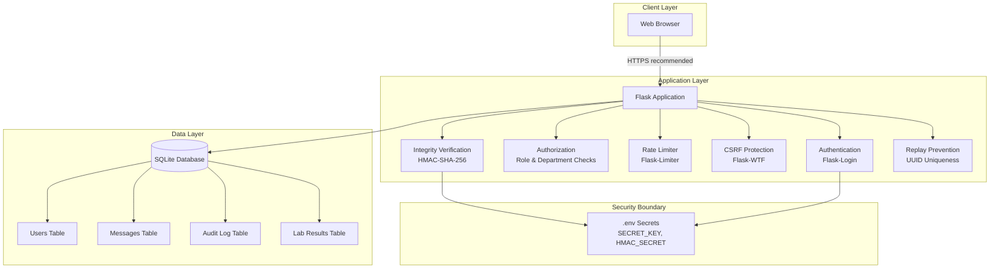

# Architecture and Data Flow

## Overview

The Airport Communications Security system is a Python Flask web application using SQLite for persistence, with server-side template rendering and session-based authentication.

## Architecture Diagram



## Trust Boundaries

1. **Browser → Server:** All user input is untrusted. Server validates and sanitizes. CSRF tokens protect state-changing requests.
2. **Server → Database:** Parameterized queries via SQLAlchemy ORM prevent SQL injection.
3. **Secrets:** SECRET_KEY and HMAC_SECRET stored in `.env`, excluded from version control.

## Data Flow: Message Sending

1. Authenticated user submits compose form with CSRF token and idempotency key.
2. Server validates department access permissions.
3. Server checks idempotency key for duplicate/replay.
4. Server computes HMAC-SHA-256 over canonical message representation.
5. Message stored with HMAC tag.
6. Audit event logged.

## Data Flow: Message Reading

1. Authenticated user requests message by ID.
2. Server checks department-level access permission.
3. Server recomputes HMAC and compares with stored tag.
4. Message displayed with integrity status indicator.

## Directory Structure

```
├── app/
│   ├── __init__.py          # App factory, extensions
│   ├── models.py            # User, Message, AuditLog, LabResult
│   ├── routes.py            # Auth, messaging, admin, lab blueprints
│   ├── templates/           # Jinja2 HTML templates
│   └── static/css/          # Stylesheet
├── tests/
│   ├── conftest.py          # Fixtures
│   └── test_app.py          # 27 automated tests
├── docs/                    # Academic documentation
├── config.py                # Configuration classes
├── seed.py                  # Demo data provisioning
├── run.py                   # Application entry point
├── requirements.txt         # Python dependencies
└── .env.example             # Environment variable template
```

## Database Schema

| Table | Purpose | Key Fields |
|-------|---------|------------|
| users | User accounts | username, password_hash, role, department, is_active_user |
| messages | Operational messages | message_uuid, sender_id, recipient_department, subject, body, hmac_tag, timestamp_str |
| audit_logs | Security events | event_type, actor_id, target, outcome, detail, correlation_id |
| lab_results | Attack lab test runs | run_id, scenario, mode, expected/observed outcome, passed, evidence |

## Permission Matrix

| Role | Send Messages | Read Own Dept | Read All Depts | Admin Panel | Audit Log | Attack Lab |
|------|:---:|:---:|:---:|:---:|:---:|:---:|
| Operator (own dept) | Own dept only | Yes | No | No | No | No |
| Operator (Ops Control) | All depts | Yes | Yes | No | No | No |
| Admin | All depts | Yes | Yes | Yes | Yes | Yes |
| Security Analyst | All depts | Yes | Yes | No | Yes | Yes |
